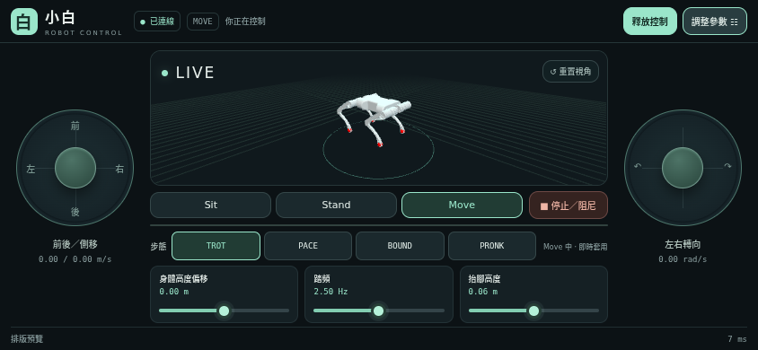

# little_white_rl_deploy

小白四足機器人的 Walk These Ways（WTW）RL 部署程式，透過 Unitree DDS 接收關節與 IMU 資料，執行 TorchScript policy，送出關節目標與 PD 增益。提供手機網頁、pygame 鍵盤與終端機三種操作方式。



*介面示意圖使用測試狀態資料。手機橫向時，左搖桿控制前後與側移，右搖桿控制轉向，3D 模型固定在中央。*

## 功能

- 依實際 DDS 回傳的 12 顆關節角度與 IMU 更新 3D URDF 姿態。
- Sit／Stand／Move／阻尼停止，主畫面快速切換 TROT／PACE／BOUND／PRONK。
- 高度、踏頻、抬腳高度滑桿，以及俯仰、側傾、站距等進階參數。
- 單一裝置控制權、300 ms 操控逾時與 DDS 狀態逾時處理。
- 網頁資源隨專案提供，運行時不需要 Node.js、CDN 或外網。

目前驗證範圍為 MuJoCo＋真實 DDS 通路，以及 Chromium 的手機觸控模擬；實體手機與機載實機需要另行驗證。

## 快速開始

需要 Linux、Python 3.10 以上，以及已安裝 Unitree SDK2 Python／CycloneDDS 的機器人環境。若目前使用 `wtw-mjlab`，啟用該環境後，在本專案根目錄執行：

```bash
uv pip install --python "$(python -c 'import sys; print(sys.executable)')" -r requirements/web.txt
python little_white_wtw.py --check
```

沒有 uv、但環境有 pip 時，可改用 `python -m pip install -r requirements/web.txt`。全新環境、SDK 安裝及各種依賴組合請看 [安裝說明](docs/installation.md)。

先在另一個終端機啟動現有模擬器。本專案預期與 `csl_mujoco` 並排：

```text
workspace/
├── little_white_rl_deploy/
└── csl_mujoco/
```

```bash
cd ../csl_mujoco/simulate_python
python unitree_mujoco.py
```

模擬器使用 `little_white_v3`、DDS domain 1、介面 `lo`。接著回到本專案啟動網頁：

```bash
python little_white_wtw.py lo --web
```

電腦開啟 `http://127.0.0.1:8080`；手機連上相同路由器後，開啟 `http://電腦IP:8080`。操作順序為 **取得控制 → Stand → 等待轉換完成 → Move**。

`lo` 是同一台電腦內模擬器與 Controller 之間的 DDS 介面，手機使用 HTTP／WebSocket 連線。

## 其他操作方式

```bash
# pygame 鍵盤面板，需要圖形桌面與 requirements/keyboard.txt
python little_white_wtw.py lo

# 僅使用終端機
python little_white_wtw.py lo --no-gui

# 自訂網頁連接埠或控制設定
python little_white_wtw.py lo --web --web-port 8081
python little_white_wtw.py --config little_white_wtw.yaml --web
```

終端機指令包括 `stand`、`sit`、`move`、`stop`、`gait trot`、`cmd frequency 2.8`、`status`、`exit`。完整網頁操作與通訊介面請看 [網頁控制台說明](web/README.md)。

## 專案結構

```text
little_white_rl_deploy/
├── little_white_wtw.py       # 啟動入口、policy runtime、DDS Controller
├── little_white_wtw.yaml     # 預設模型、通訊與控制設定
├── wtw_commands.py          # 共用指令、參數範圍、步態
├── wtw_teleop.py            # pygame 鍵盤面板
├── requirements.txt        # 基礎 Python 依賴入口
├── requirements/           # base／web／keyboard／dev 依賴組合
├── pre_train/              # policy 與 metadata，兩者成對保存
├── web/
│   ├── control.py          # 控制權、指令驗證、操控逾時
│   ├── bridge.py           # Controller 與網頁子程序之間的有界 IPC
│   ├── server.py           # FastAPI、HTTP、WebSocket
│   ├── frontend/           # TypeScript、CSS、Three.js 與模型原始資源
│   └── dist/               # 已建置的離線網頁，納入 Git
├── tests/                  # 單元測試、DDS／瀏覽器整合、效能量測
└── docs/                   # 安裝、架構、驗證記錄與介面截圖
```

保留根目錄的既有入口與 YAML 路徑，現有啟動指令可繼續使用。預設 policy 為 `wtw_stand_still`；另一份 `wtw_idle_consistent_v3` 是候選模型，詳見 [模型說明](pre_train/README.md)。

## 開發與驗證

```bash
uv pip install --python "$(python -c 'import sys; print(sys.executable)')" -r requirements/dev.txt
python -m pytest -q tests
python little_white_wtw.py --check-mapping ../csl_mujoco/unitree_robots/little_white_v3/scene.xml

cd web/frontend
npm ci
npm run build
npm test
```

修改前端後，將新的 `web/dist/` 與原始碼一起提交。整合測試、效能測試及既有結果見 [驗證記錄](docs/validation.md)，資料流與控制邏輯見 [架構說明](docs/architecture.md)。

## 提交到 GitHub

納入程式、設定、兩份 policy／metadata、前端原始碼、`package-lock.json`、`web/dist/`、文件及資源授權。`.gitignore` 會排除虛擬環境、`node_modules`、快取、日誌、測試結果及 `*.local.yaml` 等本機設定。

先確認 `origin` 是要推送的 repository，再提交目前工作樹的變更：

```bash
git remote -v
git status --short
git add -A
git diff --cached --stat
git commit -m "Add WTW deployment and offline phone dashboard"
git push origin HEAD
```

`git add -A` 也會記錄工作樹中已刪除的舊檔案；提交前可用 `git diff --cached --name-status` 確認。

第三方 URDF／mesh 來源授權保存在 `web/frontend/public/robot/LICENSE`，Three.js 與 URDFLoader 的授權保存在 `web/frontend/public/licenses/`，並隨 `web/dist/` 提供。
