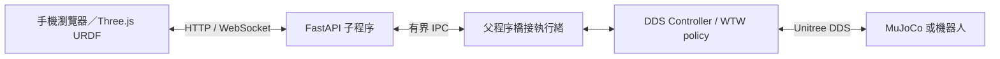

# 程式架構

## 執行入口

`little_white_wtw.py` 保留原有入口、相鄰 YAML 預設路徑與 CLI。`WTWPolicy` 負責模型合約、觀測歷史、關節索引與推論；`Controller` 負責狀態接收、模式切換與 DDS 發送。

`wtw_commands.py` 是指令名稱、步態及參數範圍的共用來源。`wtw_teleop.py` 以獨立 pygame 程序提供鍵盤面板。網頁模式不啟動鍵盤面板，不使用終端機輸入迴圈。

## 網頁與控制器

`web/server.py` 僅處理 HTTP、WebSocket、JSON 與靜態資源，不持有 DDS 發送端或 policy。`web/bridge.py` 在父程序接收有界佇列中的指令，建立最新狀態快照；慢速觀看端不累積完整狀態串流。

`web/control.py` 處理控制權、數值範圍、模式與操控逾時。Controller 本身每個控制週期檢查 watchdog，因此 HTTP 子程序卡住或崩潰也不能永久沿用移動命令。

目前排程目標為 DDS 發送 200 Hz、policy 推論 50 Hz、網頁狀態推送 30 Hz、手機操控／心跳 20 Hz。這些是軟體排程目標，不是硬即時保證。

## 狀態與模式

- 初始為 `stop` 阻尼模式。使用者先取得控制，完成 `stand` 轉換後才能從網頁進入 `move`。
- `stand`／`sit` 使用固定關節姿態；滑桿參數可預設，`move` 時交給 RL 使用。
- `move` 的速度指令來自菇菇頭；步態與參數更新保留觀測歷史和相位。
- 控制權或模式改變會更新 epoch，過期 epoch 的菇菇頭封包拒絕。
- 操控逾時 300 ms：速度歸零，若原本為 Move 則返回 Stand。DDS 狀態逾時優先切阻尼。

## 3D 顯示

前端使用 TypeScript、Three.js 與 URDFLoader。依 `motor_joints` 將 DDS motor slot 對應到 URDF joint 名稱，將 IMU 四元數從 wxyz 轉成 xyzw。場景採 X 前、Y 左、Z 上。

機身固定置中，展示高度為固定值；不將速度指令積分成世界位置。模型依實際回傳角度與姿態更新，資料過期時凍結最後畫面。完整介面與操作說明見 [web/README.md](../web/README.md)。
