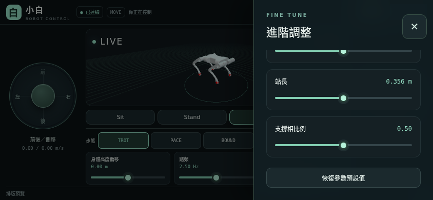

# 驗證記錄

## 執行方式

在已安裝開發依賴與 SDK 的環境，從 repository 根目錄執行：

```bash
python -m pytest -q tests
python little_white_wtw.py --check
python little_white_wtw.py --check-mapping ../csl_mujoco/unitree_robots/little_white_v3/scene.xml
python tests/run_web_smoke.py --browser /opt/google/chrome/chrome
python tests/benchmark_web.py
```

整合測試需要同層的 `csl_mujoco`；預設使用隔離 DDS domain 71／HTTP 18888，效能測試使用 domain 72／HTTP 18889。Chrome 路徑可換成實際 Chromium 執行檔。`web/test-results/` 放置執行產物，已排除在 Git 外。

## 基礎驗證（2026-10-15）


- Python 控制與 HTTP／WebSocket 邊界測試：25 項通過。
- TypeScript 檢查、Vite 正式建置、前端座標／死區／關節名稱映射測試通過；npm 安裝稽核為 0 個已知漏洞。
- 既有 `--check` 與 `--check-mapping` 通過，12 個 actuator／位置與速度 sensor 的順序一致。
- 隔離 domain 71 的 MuJoCo＋正式網頁 CLI＋Chromium 整合測試通過；包含雙指、滑桿、背景釋放、SIGKILL 網頁子程序及 DDS 中斷。

同一台電腦、每段取樣 5 秒的控制週期測量如下。數值是本次觀測，不是硬即時保證：

| 情境 | DDS 發送 | Policy 推論 | 發送間距 p99 | 推論間距 p99 |
|---|---:|---:|---:|---:|
| 無網頁 | 199.99 Hz | 50.35 Hz | 6.405 ms | 20.267 ms |
| 網頁＋10 個觀看連線 | 199.99 Hz | 50.00 Hz | 6.223 ms | 20.079 ms |

## 手機版面調整（2026-10-15）

使用 Chromium 手機觸控模擬，在 844×390、667×375、640×360、932×430、1024×600、740×320、568×320、390×844、1440×900 檢查版面。

- 橫向為左搖桿、中央 LIVE 模型、右搖桿，沒有水平溢出。
- 基本滑桿與四個快速步態按鈕可直接操作；步態高亮以後端確認狀態為準。
- 進階面板捲到底後，48 px 關閉按鈕仍可觸控；點面板外亦可關閉。
- 雙指方向／轉向控制與觸控取消歸零正常。

版面檢查使用測試狀態資料；實際 DDS 控制通路的結果列在基礎驗證中。實體手機、iOS Safari 與機載實機尚需後續驗證。



