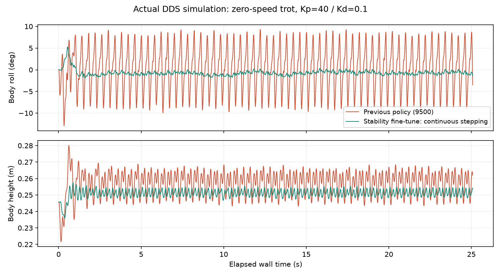

# WTW 40/0.1 · continuous trot stability · 2026-11-05

`little_white_wtw.yaml` 的預設模型。零速度持續真正原地踏步，不使用固定站姿替代。
Kp=40、Kd=0.1；70 維 × 30 幀，50 Hz 推論、200 Hz PD。
預設 trot 2.5 Hz、duty 0.5、抬腳命令 0.06 m。

從原 40/0.1 訓練的第 500 輪初始化，先做 300 輪機身穩定性微調，再做 300 輪方向保留微調。
訓練加入 roll/pitch 角速度、垂直震動與身高誤差懲罰，並保留後退、側移、左右轉與其他步態練習。
各段初始化、訓練設定、來源程式及完整模型 SHA256 見 metadata。

## 驗證

正式測試每項使用 20 seeds、每回合 20 秒，摘要見 `acceptance.json`：

- mjlab：機身穩定性 3/3、速度追蹤 7/7、四步態時序 4/4、切換 1/1 全部通過。
- standalone MuJoCo：trot 0、0.15、0.3 m/s 機身穩定性 3/3 通過。
- 完整 DDS（實際 unitree_mujoco Python 環境／MuJoCo 3.8，獨立 domain）：零速持續踏步 25 秒，
  roll 峰對峰約 2.08°、pitch 約 1.61°、高度起伏約 8.7 mm。
  原第 9,500 輪的對應數據為 roll 約 19.2°、高度起伏約 26.2 mm。

機身穩定性門檻：roll/pitch 峰對峰各 <=3°、高度起伏 <=15 mm，並保留步頻及接觸時序門檻。
四步態時序通過不等於所有步態都有相同的機身穩定性；機身門檻針對 trot。
本次未重新驗證負重、坡面、廣泛身高／姿態參數與實機，不將基本步態合格擴大成這些能力的保證。

policy 與 metadata 成對保存，來源權重不依賴訓練專案才能部署。

已部署設定另通過完整 DDS 的原地踏步→前進→回到原地踏步銜接測試，未跌倒；歸零後仍持續踏步。
